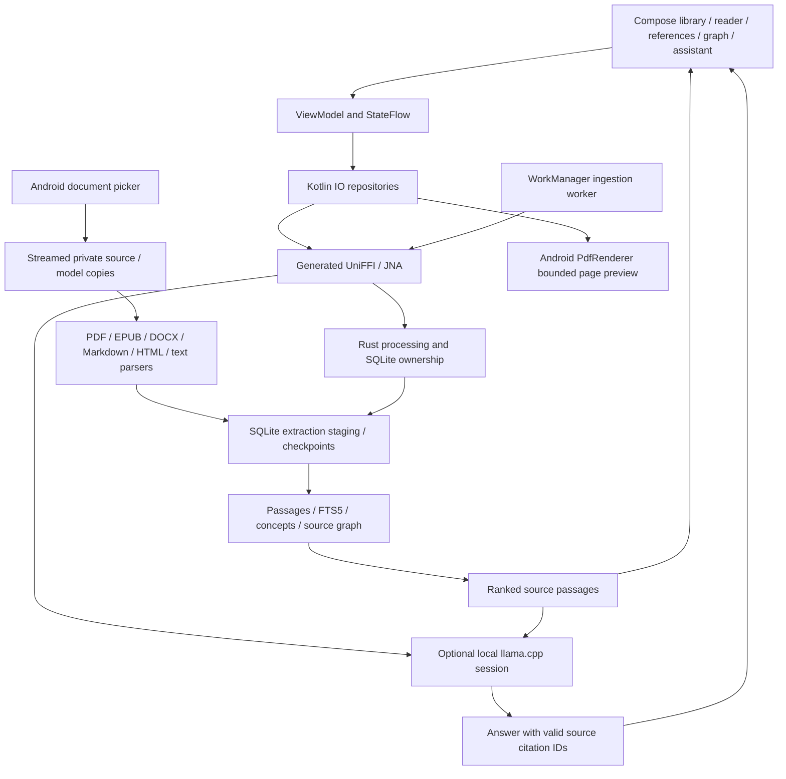

# Working MVP architecture

Entangle has one native Android application module and three Rust crates. All library, reader, reference, knowledge and assistant screens consume actual imported records. Product fixtures and demo content were removed when the user's scope expanded from initialization to a working MVP.

## Ownership and processing

`entangle-core` exclusively owns `library.sqlite`, schema migrations and source indexing. Android never opens it through Room. A native engine owns a mutex-protected connection, foreign keys, WAL, a finite busy timeout and a 2 MiB SQLite cache budget. Calls run through Kotlin IO coroutines. WorkManager owns scheduling in its separate Android database; it processes at most 32 staged passages per native call and yields between calls.

Migrations v1/v2 are transactional and preserve existing records. Unsupported future versions fail visibly. The import adapter streams a 64 KiB buffer into private storage and assigns a UUID; no broad storage permission is needed. Extraction uses specialized parsers, preserves page/section locations and stages results in SQLite. Indexing batches commit passages, FTS entries, mentions, assertions and evidence together, with checkpoints surviving process restarts. A pause requested through another database connection survives extraction staging. Explicit resumes replace a finishing paused worker to avoid losing a resume request.

Parsing/indexing bounds are 64 MiB sources, 64 MiB extracted text, 10,000 passages and128 MiB expanded archive content. Exceeding a bound fails before staged indexing rather than returning a silently truncated ready document. The initial parsing step is bounded but synchronous; indexing is checkpointed after extraction. OCR is not included, and scanned-only sources retain their visual reader while reporting the indexing limitation.

## Reading and references

PDF pages are rendered with Android PdfRenderer; each bitmap is bounded to two million pixels (~8 MB RGBA) and native page/file/renderer handles are closed. Reflow formats use actual extracted passages. The reader supports contents, search, exact text selection, notes/highlights/bookmarks and persistent source locations.

Material 3 window width classes determine layout: compact/medium windows use a bottom sheet; expanded windows use a collapsible, width-adjustable side panel. Compact windows use bottom navigation; wider windows use a rail. A panel has independent concept/list/preview state and does not call primary document navigation. The reader guards against loading/resize-induced scroll clamps and restores its anchor after the side panel closes. User-driven primary-reader scrolling remains independently usable.

## Concepts and graph

The deterministic keyphrase extractor is domain-independent: it normalizes Unicode concepts, indexes aliases and exact UTF-8 mention spans, and ranks phrase candidates using lexical evidence. It does not pretend to be a trained entity model. Mentions retain actual source passages.

The graph stores `CO_OCCURS_WITH` edges among at most 8 selected concepts per passage (28 edges), alongside separate source-specific assertions and evidence. Up to 12 concepts are retained for reference selection. Verification states say observed text/co-occurrence; no medical-specific ontology or unsupported semantic relation is inferred. Conflicting source explanations stay in their own passages/assertions and can be compared by retrieval/assistant rather than silently merged.

## Assistant and inference

Evidence mode performs actual FTS retrieval, groups results across sources, and returns exact excerpts and navigation links. It needs no model. Optional model mode supplies numbered, bounded local evidence to a modular `entangle-inference` adapter using mature llama.cpp bindings. Llama.cpp grammar-constrained generation restricts citations to source IDs actually retained in the prompt. Source identity is checked; generated claims are still assessed using the exact source cards.

GGUF weights are imported through SAF, validated and stored privately. The runtime rejects concurrent requests, caps model file size/context/output/threads/deadline, observes cancellation between decode batches/tokens, and drops model/context/backend memory after each request. Android memory-pressure callbacks cancel inference and release reader previews. No remote inference or permanent model pool is created.

## Privacy and boundaries

There is no Internet permission, account requirement, backend or telemetry. App storage is under `noBackupFilesDir`; cloud backup/device-transfer rules exclude application data. A cloud document provider may download a chosen file during SAF import; after the copy, Entangle reads local bytes. Model weights and user sources are excluded from Git and APK assets.

Domain/data/UI separation remains in Kotlin packages; Rust processing, bindings and inference are separate crates. Empty modules, a second database engine, DuckDB, a vector index and a custom renderer/runtime are avoided. See the decision records, source model and dependency audit.
